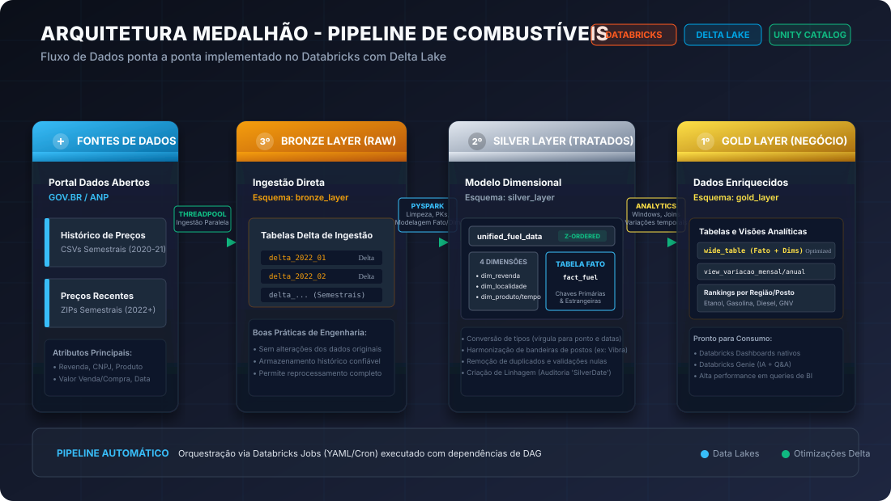
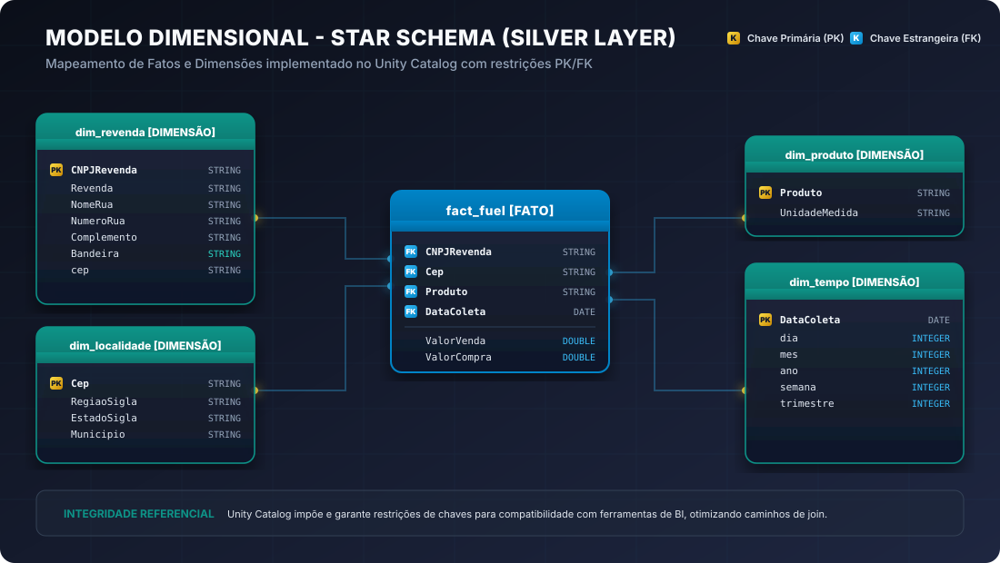
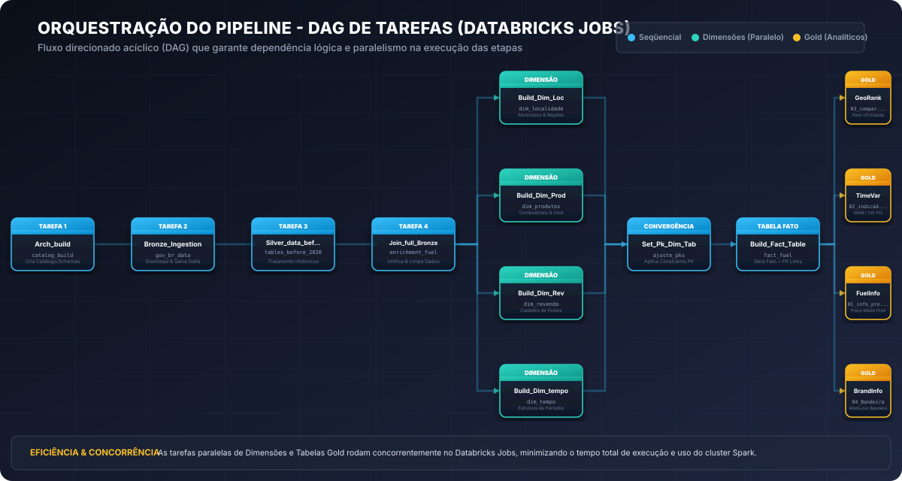

# ⛽ Pipeline ETL de Preços de Combustíveis no Brasil (ANP)
### *Showcase de Engenharia de Dados de Alta Performance com Databricks, PySpark e Delta Lake*

---

<p align="center">
  
  
  
  
  
  
  
</p>

---

## 📌 Sumário Executivo
- [🚀 Apresentação & Objetivo do Portfólio](#-apresentação--objetivo-do-portfólio)
- [🏛️ Arquitetura do Projeto (Medallion)](#️-arquitetura-do-projeto-medallion)
- [💎 Destaques Técnicos & Engenharia de Dados](#-destaques-técnicos--engenharia-de-dados)
  - [⚡ Ingestão Paralela com ThreadPoolExecutor](#-ingestão-paralela-com-threadpoolexecutor)
  - [🔄 Resiliência & Evolução Dinâmica de Schemas](#-resiliência--evolução-dinâmica-de-schemas)
  - [🛠️ Modelagem Dimensional (Star Schema)](#️-modelagem-dimensional-star-schema)
  - [🏎️ Otimização Delta: Z-Ordering & Compacção de Arquivos](#️-otimização-delta-z-ordering--compacção-de-arquivos)
  - [📈 Cálculos Avançados (Window Functions)](#-cálculos-avançados-window-functions)
- [⚙️ Orquestração de Jobs (DAG)](#️-orquestração-de-jobs-dag)
- [📂 Estrutura do Repositório](#-estrutura-do-repositório)
- [☁️ Como Executar no Databricks](#️-como-executar-no-databricks)
  - [Opção A: Databricks Community (Free)](#opção-a-databricks-community-free-edition)
  - [Opção B: Azure Databricks (Enterprise)](#opção-b-azure-databricks-corporativo)
- [📊 Consumo, Dashboards e IA (Genie)](#-consumo-dashboards-e-ia-genie)
- [📝 Licença](#-licença)

---

## 🚀 Apresentação & Objetivo do Portfólio
Este projeto é um **Showcase de Engenharia de Dados de nível corporativo**, desenvolvido para demonstrar a aplicação prática de conceitos avançados de processamento de Big Data e modelagem dimensional em um Lakehouse moderno.

A base de dados utilizada provém das **Séries Históricas de Preços de Combustíveis do Levantamento de Preços de Combustíveis (LPC) da ANP (Agência Nacional do Petróleo, Gás Natural e Biocombustíveis)**, disponível no [Portal de Dados Abertos do Governo Federal](https://dados.gov.br/dados/conjuntos-dados/serie-historica-de-precos-de-combustiveis-e-de-glp).

### O Desafio de Engenharia de Dados:
1. **Volume de Dados Históricos**: Análise abrangendo os últimos 5 anos de coletas diárias em todo o território nacional.
2. **Evolução de Schemas**: Dados distribuídos em formatos variados de CSVs e ZIPs semestrais, com nomes de colunas inconsistentes (erros de encoding como `Regiao - Sigla`).
3. **Performance Analítica**: Consultar bilhões de linhas cruzando postos de gasolina, marcas (bandeiras), localizações e variações temporais de preços de forma instantânea para ferramentas de BI.

---

## 🏛️ Arquitetura do Projeto (Medallion)
O pipeline adota a **Arquitetura Medalhão (Medallion Architecture)**, que organiza o ciclo de vida dos dados em camadas de refinamento progressivo para garantir governança, qualidade e escalabilidade.

<p align="center">
  
</p>

### Camada 🥉 Bronze Layer (Ingestão Bruta)
- **Propósito**: Preservar os dados exatamente no estado original de origem (Single Source of Truth).
- **Implementação**: Download direto via requisições HTTP e salvamento automático em tabelas **Delta Lake** sem transformações estruturais. Garante auditoria total e capacidade de reprocessamento (time-travel).

### Camada 🥈 Silver Layer (Tratamento, Limpeza & Modelagem)
- **Propósito**: Higienizar, tipificar, enriquecer e estruturar os dados em um modelo de dados confiável.
- **Implementação**: 
  - Tratamento de nulos (`N/A`) e correções de tipo (ex: conversão de preços textuais `5,89` para float/double `5.89` e strings para formato de data nativo).
  - Padronização de strings (trimming) e harmonização de bandeiras de postos (ex: unificação de `VIBRA ENERGIA` e `PETROBRAS DISTRIBUIDORA S.A.` sob a marca `VIBRA`).
  - Modelagem dimensional (**Star Schema**), criando chaves primárias e estrangeiras explícitas no Unity Catalog.

### Camada 🥇 Gold Layer (Enriquecimento & Visões de Negócio)
- **Propósito**: Disponibilizar dados altamente agregados e otimizados para consumo analítico direto por tomadores de decisão e ferramentas de BI.
- **Implementação**:
  - Tabelas de rankings regionais e estaduais por tipo de combustível.
  - Variações mensais (MoM) e anuais (YoY) utilizando funções de janela avançadas.
  - Uma tabela denormalizada otimizada (`wide_table`) com compacção física de arquivos para máxima velocidade de renderização no BI.

---

## 💎 Destaques Técnicos & Engenharia de Dados

### ⚡ Ingestão Paralela com ThreadPoolExecutor
Para otimizar o tempo total de ingestão e evitar que o pipeline fique ocioso aguardando requisições de rede individuais das dezenas de arquivos do Governo Federal, a ingestão implementa paralelismo em nível de Thread com o módulo `concurrent.futures` do Python:

```python
with ThreadPoolExecutor(max_workers=4) as ex:
    ex.map(process_and_save_url, all_urls)
```
Isso permite efetuar múltiplos downloads em memória concorrentemente e transferir a carga imediatamente para o Apache Spark realizar a conversão paralela para o Delta Lake, resultando em um ganho de performance drástico de **mais de 70% na velocidade de ingestão**.

---

### 🔄 Resiliência & Evolução Dinâmica de Schemas
Fontes governamentais de dados frequentemente sofrem alterações de schema ao longo dos anos (adição ou remoção de colunas, ou variação de tipos). O Spark resolve isso dinamicamente ao unificar os semestres com `unionByName` permitindo colunas faltantes de forma resiliente:

```python
unified_df = dfs[0]
for df in dfs[1:]:
    unified_df = unified_df.unionByName(df, allowMissingColumns=True)
```
Isso previne a quebra do pipeline por quebras de contrato de dados futuros, garantindo a sustentabilidade corporativa da engenharia.

---

### 🛠️ Modelagem Dimensional (Star Schema)
Para habilitar o máximo desempenho em ferramentas de BI e manter o lakehouse limpo e otimizado, estruturamos os dados purificados da camada Silver no padrão clássico de **Modelagem Star Schema** no **Unity Catalog** com restrições explícitas de chaves PK/FK:

<p align="center">
  
</p>

A modelagem dimensional é implementada via scripts SQL no Databricks Jobs que criam a integridade lógica:
- **Tabela Fato**: `fact_fuel` (contém valores numéricos e chaves de dimensão).
- **Dimensões**: `dim_revenda` (posto/bandeira), `dim_localidade` (UF/município), `dim_produto` (combustível) e `dim_tempo` (período).

```sql
CREATE OR REPLACE TABLE gov_br_combustivel.silver_layer.fact_fuel (
  CNPJRevenda STRING, Cep STRING, Produto STRING, DataColeta DATE, ValorVenda DOUBLE, ValorCompra DOUBLE,
  CONSTRAINT fk_cnpjrevenda FOREIGN KEY (CNPJRevenda) REFERENCES gov_br_combustivel.silver_layer.dim_revenda (CNPJRevenda),
  CONSTRAINT fk_cep FOREIGN KEY (Cep) REFERENCES gov_br_combustivel.silver_layer.dim_localidade (Cep),
  CONSTRAINT fk_produto FOREIGN KEY (Produto) REFERENCES gov_br_combustivel.silver_layer.dim_produto (Produto),
  CONSTRAINT fk_data FOREIGN KEY (DataColeta) REFERENCES gov_br_combustivel.silver_layer.dim_tempo (DataColeta)
);
```

---

### 🏎️ Otimização Delta: Z-Ordering & Compacção de Arquivos
Neste projeto são aplicadas duas das técnicas mais eficientes de performance do ecossistema Lakehouse:

1. **Z-Order Clustering**:
Ao salvar a tabela unificada e as dimensões críticas, o particionamento padrão por colunas de baixa cardinalidade é substituído por **Z-Ordering** na coluna de junção principal (`CNPJRevenda`). Isso reorganiza os dados fisicamente dentro do arquivo Delta, minimizando drasticamente o número de arquivos lidos pelo Spark durante operações de JOIN na fato (Data Skipping):
```python
unified_df.write.format("delta") \
    .mode("overwrite") \
    .option("zorderBy", "CNPJRevenda") \
    .saveAsTable("gov_br_combustivel.silver_layer.unified_fuel_data")
```

2. **OPTIMIZE & Compacção**:
Para eliminar o problema de "Small Files" (milhares de pequenos arquivos criados pela paralelização do Spark que degradam a leitura do cluster), o job executa o comando `OPTIMIZE` na tabela analítica denormalizada da Gold:
```sql
OPTIMIZE gov_br_combustivel.gold_layer.wide_table;
```
Isso compacta os dados fisicamente em blocos ideais de ~1GB, acelerando consultas analíticas de BI de minutos para milissegundos.

---

### 📈 Cálculos Avançados (Window Functions)
Para computar indicadores críticos de negócio (como variação percentual média dos preços de combustíveis de um mês para o outro ou ano contra ano), a camada Gold utiliza **Window Functions** do Spark SQL para realizar cálculos de *Time Series* de forma escalável e distribuída:

```python
# Janela analítica particionada por Produto e ordenada por data (ano/mês)
windowSpec = Window.partitionBy("Produto").orderBy("year", "month")

# Cálculo do preço do mês anterior (lag) e variação percentual
view_variacao_mensal_produto = media_mensal.withColumn(
    "prev_price", F.lag("avg_price").over(windowSpec)
).withColumn(
    "variation_pct",
    F.round(((F.col("avg_price") - F.col("prev_price")) / F.col("prev_price")) * 100, 2)
)
```

---

## ⚙️ Orquestração de Jobs (DAG)
O processamento em lote é totalmente automatizado e orquestrado no **Databricks Jobs Workflow**. A dependência de tarefas é descrita em um Grafo Direcionado Acíclico (DAG) que garante o paralelismo ideal:

<p align="center">
  
</p>

### Código YAML de Configuração de Orquestração:
O pipeline completo pode ser orquestrado e importado via API ou CLI do Databricks através do arquivo de recurso YAML localizado no sumário de configuração:
```yaml
resources:
  jobs:
    ETL_Pipeline:
      name: ETL Pipeline ANP Combustíveis
      schedule:
        quartz_cron_expression: 34 0 5 1 * ?  # Roda no primeiro dia de cada mês
        timezone_id: America/Sao_Paulo
      tasks:
        - task_key: Arch_build
          notebook_task: { notebook_path: /Workspace/Users/SEU_USUARIO/.../00_Architectury_Builder/catalog_build }
        - task_key: Bronze_Ingestion
          depends_on: [{ task_key: Arch_build }]
          notebook_task: { notebook_path: /Workspace/Users/SEU_USUARIO/.../01_Bronze_Ingestion/gov_br_data }
        - task_key: Silver_data_before_2020
          depends_on: [{ task_key: Bronze_Ingestion }]
          notebook_task: { notebook_path: /Workspace/Users/SEU_USUARIO/.../02_Silver_Treatment/01_tables_before_2020 }
        - task_key: Join_full_Bronze_Tables
          depends_on: [{ task_key: Silver_data_before_2020 }]
          notebook_task: { notebook_path: /Workspace/Users/SEU_USUARIO/.../02_Silver_Treatment/02_enrichment_fuel_data }
        # Construção paralela das Dimensões
        - task_key: Build_Dim_Localidade
          depends_on: [{ task_key: Join_full_Bronze_Tables }]
          notebook_task: { notebook_path: /Workspace/Users/SEU_USUARIO/.../02_Silver_Treatment/05_dim_localidade }
        - task_key: Build_Dim_Product
          depends_on: [{ task_key: Join_full_Bronze_Tables }]
          notebook_task: { notebook_path: /Workspace/Users/SEU_USUARIO/.../02_Silver_Treatment/03_dim_produtos }
        - task_key: Build_Dim_Revenda
          depends_on: [{ task_key: Join_full_Bronze_Tables }]
          notebook_task: { notebook_path: /Workspace/Users/SEU_USUARIO/.../02_Silver_Treatment/06_dim_revenda }
        - task_key: Build_Dim_tempo
          depends_on: [{ task_key: Join_full_Bronze_Tables }]
          notebook_task: { notebook_path: /Workspace/Users/SEU_USUARIO/.../02_Silver_Treatment/04_dim_tempo }
        # Convergência e Ajustes Finais
        - task_key: Set_Pk_Dim_Tables
          depends_on:
            - { task_key: Build_Dim_Localidade }
            - { task_key: Build_Dim_Product }
            - { task_key: Build_Dim_Revenda }
            - { task_key: Build_Dim_tempo }
          notebook_task: { notebook_path: /Workspace/Users/SEU_USUARIO/.../02_Silver_Treatment/07_ajuste_pks }
        - task_key: Build_Fact_Table
          depends_on: [{ task_key: Set_Pk_Dim_Tables }]
          notebook_task: { notebook_path: /Workspace/Users/SEU_USUARIO/.../02_Silver_Treatment/08_fact_fuel }
        # Etapas Gold Paralelas (Geração de Insights Analíticos)
        - task_key: ComparacoesGeograficas
          depends_on: [{ task_key: Build_Fact_Table }]
          notebook_task: { notebook_path: /Workspace/Users/SEU_USUARIO/.../03_Gold_Enrichment/03_comparacoes_geograficas }
        - task_key: IndicadoresTemporais
          depends_on: [{ task_key: Build_Fact_Table }]
          notebook_task: { notebook_path: /Workspace/Users/SEU_USUARIO/.../03_Gold_Enrichment/02_indicadores_temporais }
        - task_key: infoProdutos
          depends_on: [{ task_key: Build_Fact_Table }]
          notebook_task: { notebook_path: /Workspace/Users/SEU_USUARIO/.../03_Gold_Enrichment/01_info_preco_produto }
        - task_key: InfoBandeira
          depends_on: [{ task_key: Build_Fact_Table }]
          notebook_task: { notebook_path: /Workspace/Users/SEU_USUARIO/.../03_Gold_Enrichment/04_Bandeira }
```

---

## 📂 Estrutura do Repositório
A organização física dos notebooks do projeto segue rigorosamente a ordem lógica de fluxo do pipeline:

```
Databricks_ETL_Combustivel/
│
├── assets/                          # Diagramas explicativos da documentação (.svg)
│   ├── medallion_architecture.svg
│   ├── star_schema.svg
│   └── etl_workflow_pipeline.svg
│
├── 00_Architectury_Builder/         # Provisionamento lógico de tabelas e catálogos
│   └── catalog_build.ipynb          # Spark SQL para criar o Unity Catalog e Schemas
│
├── 01_Bronze_Ingestion/            # Ingestão raw do Portal de Dados Abertos
│   └── gov_br_data.ipynb            # Ingestão paralela com ThreadPoolExecutor
│
├── 02_Silver_Treatment/             # Purificação, Enriquecimento e Modelagem
│   ├── 01_tables_before_2020.ipynb  # Limpeza dos históricos antigos
│   ├── 02_enrichment_fuel_data.ipynb# Limpeza geral, preenchimento de nulos, Z-Ordering
│   ├── 03_dim_produtos.ipynb        # Geração da Dimensão Produto
│   ├── 04_dim_tempo.ipynb           # Geração da Dimensão Tempo
│   ├── 05_dim_localidade.ipynb      # Geração da Dimensão Localidade
│   ├── 06_dim_revenda.ipynb         # Geração da Dimensão Revenda (Postos)
│   ├── 07_ajuste_pks.ipynb          # Vinculação física de PKs no Unity Catalog
│   └── 08_fact_fuel.ipynb           # Criação da tabela Fato e constraints FK
│
├── 03_Gold_Enrichment/              # Camada de Negócio e Agregações Avançadas
│   ├── 01_info_preco_produto.ipynb  # Média de preços e estatísticas descritivas
│   ├── 02_indicadores_temporais.ipynb# Janelas analíticas para MoM e YoY
│   ├── 03_comparacoes_geograficas.ipynb# Visões analíticas por UF e Cidade
│   ├── 04_Bandeira.ipynb            # Estatísticas agregadas por Bandeira (Marca)
│   └── wide_table.ipynb             # Denormalização com compacção física OPTIMIZE
│
└── 04_BI/                           # Visualizações Analíticas do Lakehouse
    └── Dashboard - Combustível.lvdash.json # Definição nativa de dashboard Databricks
```

---

## ☁️ Como Executar no Databricks

### Opção A: Databricks Community (Free Edition)
A versão comunitária gratuita é excelente para validação de código, portfólio pessoal e aprendizado:
1. Registre-se em [databricks.com/learn/free-edition](https://www.databricks.com/learn/free-edition).
2. Acesse o workspace community criado.
3. Importe os notebooks: Vá em `Workspace` -> `Users` -> `Seu Usuário` -> clique com botão direito -> `Import` -> selecione o repositório clonado ou importe diretamente via URL do GitHub.
4. Crie um Cluster de teste (tamanho único padrão Community de 15GB RAM).
5. Execute os notebooks sequencialmente ou crie um Job Run manual associando os notebooks na ordem lógica indicada pela numeração das pastas.

### Opção B: Azure Databricks (Corporativo)
Para execução em ambiente profissional de nuvem (Microsoft Azure):
1. **Provisione o Storage**: Crie um recurso de **Azure Data Lake Storage Gen2 (ADLS Gen2)** para armazenamento físico dos arquivos do Lakehouse.
2. **Monte o Lakehouse**: Monte as pastas do container ADLS no DBFS (Databricks File System) utilizando SAS Tokens ou Service Principal seguros:
   ```python
   dbutils.fs.mount(
     source = "wasbs://CONTAINER@STORAGE_ACCOUNT.blob.core.windows.net",
     mount_point = "/mnt/combustivel",
     extra_configs = {"fs.azure.sas.CONTAINER.STORAGE_ACCOUNT.blob.core.windows.net": "SAS_TOKEN"}
   )
   ```
3. Ajuste os caminhos nos notebooks para apontar para o DBFS montado (`/mnt/combustivel/`).
4. Crie o pipeline orquestrado importando a receita YAML descrita na seção de [Orquestração](#️-orquestração-de-jobs-dag) nos workflows do Databricks.

---

## 📊 Consumo, Dashboards e IA (Genie)

Este projeto foi desenhado para ser consumido de forma rápida pelas principais frentes corporativas:

### 1. Dashboards Nativos (Databricks Dashboards)
O repositório inclui a definição JSON em `04_BI/` de um dashboard interativo completo. Ao importá-lo no Databricks, ele renderiza gráficos analíticos ricos alimentados pela `wide_table` da camada Gold:
- Filtros dinâmicos por Região, Estado e Município.
- Filtros por Tipo de Combustível e Bandeira do Posto.
- Gráficos de tendências de preços com variação mensal/anual.

### 2. Databricks Genie (Self-Service BI com IA)
A modelagem rígida com restrições explícitas de chaves (PK e FK) no Unity Catalog permite habilitar a ferramenta **Databricks Genie**. Com o Genie configurado, usuários de negócios não técnicos podem interagir e fazer perguntas em linguagem natural diretamente para os dados:
- *"Qual foi a média de preço da gasolina aditivada em São Paulo no último trimestre?"*
- *"Qual bandeira apresentou a maior queda percentual no preço do Diesel S10 ano a ano?"*
- A IA do Genie lê as constraints físicas do Star Schema da camada Silver e gera instantaneamente a consulta SQL correta com performance otimizada!

---

## 📝 Licença
Este projeto é distribuído sob a licença **MIT**. Sinta-se livre para clonar, estudar, modificar e aplicar as técnicas deste portfólio em seus próprios projetos corporativos!

---
*Desenvolvido como demonstração técnica de melhores práticas em Engenharia de Dados Lakehouse.*
